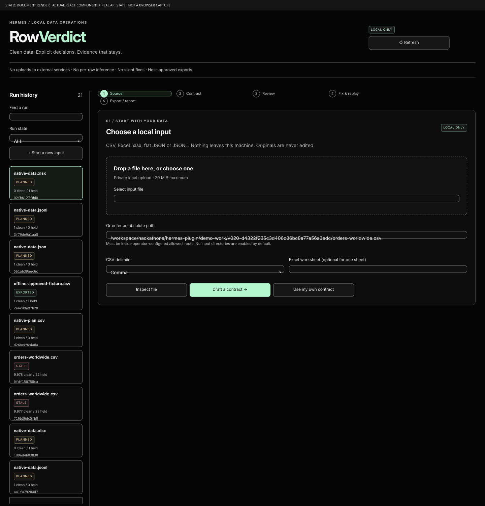
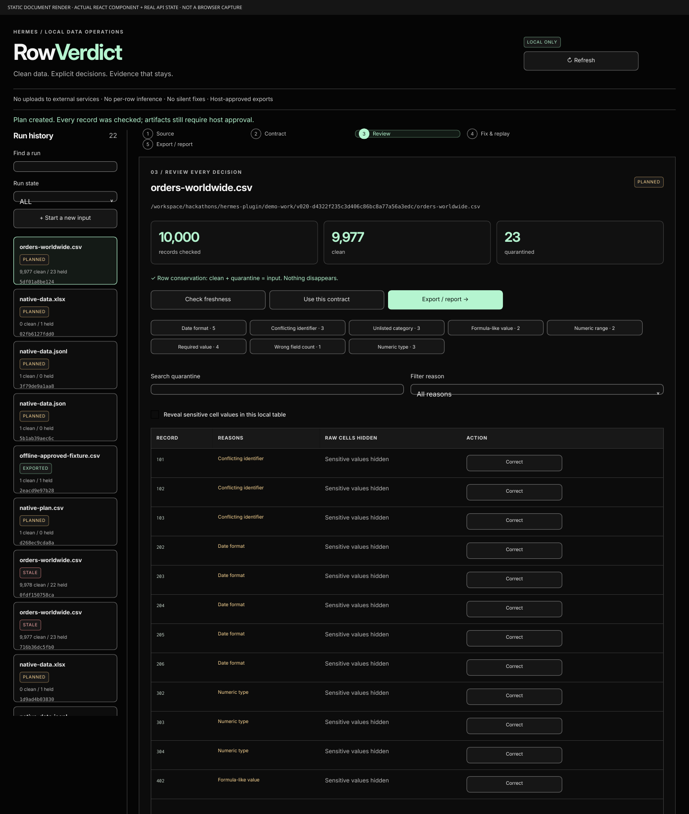

# RowVerdict for Hermes

**Clean data. Explicit decisions. Evidence that stays.**

Turn a risky import into an auditable local workflow:
**file → draft / explicit contract → human review → full-scan plan → fix & replay → host-approved export + HTML audit.**

RowVerdict is a native Hermes plugin, not an MCP wrapper or database importer. It makes no model calls, sends no data to external services, and never edits an original input.

## What 0.2.0 adds

- **Conservative contract drafts:** sampled types, string ID candidates, unambiguous dates and small category enums. Clearly `DRAFT`, never auto-applied. Even extracting a proposed contract cannot bypass the source-bound review requirement.
- **CSV, Excel `.xlsx`, flat JSON and JSONL:** bounded parsing, exact numeric text, no formula/link execution. Every record is checked when a plan is created, not just the inference sample.
- **Fix & replay:** correct quarantined records in the dashboard or supply a JSON patch. Recheck the entire dataset under the same contract, including duplicate keys. New plan, separate export approval, new receipt; no append/double-count or parent mutation.
- **Native commands and plain-English summaries:** inspect, draft, plan, status and replay. Review/export slash commands deliberately prepare a native-tool approval handoff, never an ungated write.
- **Self-contained HTML audits:** counts, policies, reasons, drift, replay/draft provenance and integrity hashes; no scripts or external assets. Raw row values are excluded.
- **A practical true-dark dashboard:** local file selection/drop, editable contract review, real plan history, EXPORTED/STALE states, paginated/searchable quarantine, correction forms, replay previews and approval-safe report download. Responsive CSS, visible keyboard focus and high-contrast text.

## Install / configure

Requires **Hermes >= 0.23.1**, Python >= 3.11 and Linux/POSIX filesystem semantics. Verified against stable `v0.23.1` (`3b421578588243f920886e6fe79a6faa87ea026e`). XLSX uses the declared **`defusedxml==0.7.1`** dependency; Hermes prepares it through its normal dependency/admission mechanism. CSV/JSON processing itself uses the standard library. FastAPI/React come from Hermes.

Install a reviewed exact commit after publication:

```bash
hermes plugins install https://github.com/demir-sama/rowverdict --ref <FULL_REVIEWED_COMMIT_SHA> --enable
hermes plugins doctor rowverdict --ci
```

For local development, copy this directory to `${HERMES_HOME:-$HOME/.hermes}/plugins/rowverdict` and enable it with Hermes. Merge these settings into the active profile's `config.yaml`:

```yaml
plugins:
  enabled: [rowverdict]
  entries:
    rowverdict:
      settings:
        allowed_roots:
          - /absolute/path/to/table-inbox
        allow_dashboard_uploads: false
```

Use a narrow, dedicated input directory, not your whole home or `.hermes`. Empty roots deny external input reads. File upload is **separately opt-in**: set `allow_dashboard_uploads: true` to permit browser-selected inputs to be copied into private `plugin-data/rowverdict/uploads`; it does not broaden access to neighboring configuration/credential files. Uploads stay local, have generated non-overwriting names and a 100-file cap. There is no retention/deletion automation. Restart the conversation/dashboard after installation or dependency changes.

## Use in Hermes

> Inspect my orders file. Draft a conservative RowVerdict contract, keep identifiers as strings, and show me the proposed date and enum rules. Do not apply the draft before I review it. Create a full plan, help me correct quarantined records, then ask for approval of the exact replay plan before exporting.

| Native tool | Behavior |
|---|---|
| `rowverdict_inspect` | Full schema/count/hash inspection; no row-value samples |
| `rowverdict_draft` | Persist a clearly labeled sample-derived DRAFT; not a plan |
| `rowverdict_review` | Request host approval of the exact proposed/edited contract; persist immutable source/policy review |
| `rowverdict_plan` | Check every row against an explicit contract or reviewed `draft_id`; persist metadata only |
| `rowverdict_replay` | Correct only quarantined records and create a new review plan; **no artifacts exported** |
| `rowverdict_history` | Read recent runs or one `plan_id`, contracts, evidence, drift and receipts |
| `rowverdict_export` | Recheck source/engine/policy/patch, request host approval and atomically publish private artifacts |

The dashboard records contract acceptance only on an explicit authenticated operator review action. This is not a generic unattended approval endpoint. Clean artifact publication is never exposed through the dashboard API.

### Slash commands

```text
/rowverdict inspect /absolute/path/orders.csv
/rowverdict draft /absolute/path/orders.csv
/rowverdict plan {"source":"/absolute/path/orders.csv","draft_id":"<REVIEWED_DRAFT_ID>"}
/rowverdict status
/rowverdict status <PLAN_ID>
/rowverdict replay {"plan_id":"<PLAN_ID>","patch":[{"row":3,"set":{"amount":"2.50"}}]}
/rowverdict review <DRAFT_ID>
/rowverdict export <PLAN_ID>
```

Quote paths containing spaces. `/rowverdict <PLAN_ID>` remains compatible. **Important stable-host limitation:** `ctx.dispatch_tool` reaches the registry without running the export pre-tool hook. Therefore `/rowverdict review|export` returns the exact native tool call to ask Hermes to invoke through its approval pipeline. It does not manufacture an approval, directly write artifacts or falsely claim an approval card was shown.

## The contract is the policy

```json
{
  "delimiter": ",",
  "unique_key": ["order_id"],
  "columns": [
    {"name":"order_id","type":"string","required":true},
    {"name":"customer","type":"string","trim":true},
    {"name":"amount","type":"decimal","decimal_separator":".","min":"0"},
    {"name":"ordered_on","type":"date","date_format":"%d/%m/%Y"},
    {"name":"status","type":"string","enum":["paid","pending","refunded"]}
  ]
}
```

- The exact ordered header must match. Schema drift never auto-approves new columns.
- Types: string, integer, decimal, date. Required defaults true; trim defaults false. Whitespace-only required values are missing, without implicit trimming of nonblank cells.
- Dates require `%Y-%m-%d`, `%d/%m/%Y` or `%m/%d/%Y`; accepted dates export as ISO. Ambiguous sampled day/month order stays **string** in drafts. A reviewed explicit format is authoritative; Python also accepts single-digit day/month parts.
- Plain ASCII numeric grammar only: optional sign and an explicit decimal separator, at most 64 characters. No currency/grouping/exponents/NaN/rounding/binary-float normalization. IDs remain strings. Decimal sums are per-column arithmetic, **not currency-converted financial totals**.
- Inclusive numeric min/max and exact transformed-string enums. Optional empty values skip type/range/enum checks.
- All members of duplicate-key groups quarantine, including otherwise-invalid records. Composite keys compare transformed strings, not inferred numeric equivalence.
- Leading `= + - @` after whitespace, or a leading tab/CR/LF, quarantines unless the cell is a valid explicitly typed number. Native Excel formula/error cells quarantine independently of the contract. No formulas are evaluated, even if cached values exist.

Draft inference uses at most the first 1,000 parsed data records. Unique-key suggestions and observed enum coverage are **not proof**. Enums are proposed only for small repeated named categories; those observed categories may appear in tool results and the configured model. Use a manual contract if category names/values are sensitive. A source with a draft proposal cannot be planned under an unreviewed proposed or edited policy; accepted drafts are immutable, and source changes require a new draft.

## Input limits / Excel and JSON semantics

All formats: 20 MiB input, 100,000 data records, 128 columns, 1,000,000 cells (including header), 65,536 characters/cell and 64 KiB normalized contract. Excesses and malformed containers refuse the whole input, never sample-pass.

- **CSV:** UTF-8/BOM, comma/semicolon/tab/pipe, strict quoting, quoted delimiters and embedded newlines. Blank/incorrect-width logical records quarantine; malformed quoting, NUL and non-UTF-8 refuse.
- **JSON:** array of flat objects, or one flat object. JSONL/NDJSON: one flat object per nonblank line; blank-line skips are reported. Keys are unioned in first-seen order; missing/null values become empty cells. Nested values, duplicate keys and non-finite constants refuse. Exact numeric tokens retain precision; exponent tokens are not guessed into plain decimals.
- **XLSX:** standard OOXML worksheet values, inline/shared strings, booleans and date-only styles. Multiple worksheets require explicit `sheet` (inspect/draft argument or contract field). No hidden first-sheet selection. Recognized date-only storage styles decode to ISO dates; invalid/fictitious 1900-02-29 and time-bearing values in date-only cells quarantine. Numeric display formatting, currency/locale formats and custom arbitrary styles are not interpreted. Store zero-padded identifiers as **text**, not numeric display formats.
- XLSX ZIP limits: 1,024 entries, 40 MiB total expansion, 32 MiB per part and a 200:1 ratio beyond 1 MiB. DTD/entities, traversal, duplicate members, macros and encryption refuse. Relationships/links are never fetched. `.xls`, `.xlsm`, Strict OOXML and general Excel calculation/display fidelity are not supported.

## Fix & replay

A patch is a JSON array, supplied inline or as a `.json` `patch_file` inside allowed roots:

```json
[{"row":3,"set":{"amount":"2.50"}}, {"row":8,"cells":["0008","Example","4.25","2026-11-11","paid"]}]
```

`row` is the 1-based **logical table record**: header=1, first data record/object=2. Excel row coordinates are retained. It is not a physical CSV/JSONL line number. At most 1,000 distinct quarantined records may change per replay. Values must be bounded strings. Wrong-width records need a complete replacement. Unknown fields, clean-row edits and repeated patch record numbers refuse.

The child rechecks **all** rows under the same contract, preserving order and conservation. It may still quarantine corrections or newly conflicting duplicate groups. Inline corrections are persisted privately in SQLite; file patches additionally bind exact patch-file bytes and must remain unchanged until export. Replay depth is capped at ten. Source, policy, engine or relevant patch changes refuse. Each child needs separate host export approval; parents and previous exports remain unchanged.

## Receipts and HTML reports

```text
<active HERMES_HOME>/plugin-data/rowverdict/
├── runs.sqlite3
├── uploads/                 # only when explicitly enabled
└── exports/<plan-id>/
    ├── clean.csv
    ├── quarantine.json
    ├── audit.html
    └── receipt.json
```

Source bytes, canonical policy, transformation modules and replay patch bind the plan. Atomic publication creates all four artifacts together with `0700` directories and `0600` files. Original files are never edited. `clean.csv` contains only accepted records; `quarantine.json` deliberately retains raw sensitive cells as JSON, not another formula-bearing spreadsheet.

The self-contained HTML audit includes counts, policy, bounded reasons, drift, provenance and source/policy/engine/data/receipt-core hashes, without scripts or external assets. The final receipt hashes `audit.html`; the report shows a canonical receipt-core hash that excludes its own artifact entry to avoid circular hashing. The receipt never hashes itself and is not an external signature. Review paths, schema and enum metadata before sharing.

Repeat exports verify existing hashes rather than overwrite. Changed unexported source/engine/patch plans become permanently STALE; restoring bytes does not revive them. EXPORTED artifacts remain historical snapshots even if inputs later change. New replay from such a parent still requires its source to match. Existing 0.1.0 plans require replanning after the engine upgrade; existing old exports retain their original artifacts and have no retroactively added HTML report.

SQLite retains paths, contracts, counts, bounded issue evidence, draft reviews, **raw correction patches** and receipts, not complete input snapshots. Sensitive data is not encrypted; there is no retention scheduler, remote signing or multi-tenant isolation.

## Dashboard / evidence

Launch `hermes dashboard`, open **RowVerdict**, then follow the numbered workflow. Local path input always obeys configured roots; file selection/drop is an explicit separate opt-in. Contract files and row edits are real inputs, never production mock data. Quarantine is paginated (25 rows), searchable/filterable, with raw values hidden in the table until revealed. Run history shows the latest 40 runs (native history supports 100). Use **Check freshness** to persist stale state and refresh after approving an export in Hermes.

The dashboard can persist review plans and explicit policy review, not publish clean artifacts. Replay buttons create review plans only. HTML preview downloads are visibly **NOT EXPORTED**; approved audit downloads verify receipt hashes and return the exact immutable HTML.





See [verification](docs/VERIFICATION.md) for test results and honest visual-QA limits. PNG document renders are generated from the actual React component with real API-backed run state; they are **not live-browser screenshots**. No interactive browser automation is used or claimed.

## Reproduce / admission

The included dataset is **10,000 synthetic worldwide orders across 20 countries**, not real customer data. Its explicit demo contract produces **9,977 clean + 23 quarantined**. No per-row inference is needed.

```bash
python3 -m pip install defusedxml==0.7.1
python3 -m unittest discover -s tests -v
node --check dashboard/dist/index.js
hermes plugins doctor /absolute/path/to/rowverdict --ci
hermes plugins validate /absolute/path/to/rowverdict --install-deps
python3 scripts/demo_run.py
```

The thirteen API integration tests use FastAPI/httpx supplied by Hermes; they skip explicitly outside that runtime. See the [demo script](demo/DEMO_SCRIPT.md) and [workflow guide](docs/WORKFLOWS.md). `cli.py` remains an explicit human-invoked offline QA interface, **never a retry path around a denied Hermes export**.

## Honest security boundary

No network calls, telemetry, credentials, subprocesses or dynamic user-code execution in the plugin runtime. Only operator-allowlisted tables / explicitly enabled private uploads are read. Known credential/configuration stores, traversal, symlinks and nonregular inputs refuse. Sources may still contain sensitive data: this is not a PII anonymizer, universal spreadsheet security guarantee, accounting system or database importer.

The pre-tool hook covers native review/export through Hermes's ordinary approval pipeline, not arbitrary terminal/file/import tools or direct Python calls. Host approval policy, including explicit unattended allowlists, remains authoritative. Local OS/account and plugin state are trusted; symlink checks do not isolate hostile same-user directory races. Windows/macOS are not certified. Full policy/sheet/format details and limitations are above; do not infer business-rule correctness or regulatory certification.

MIT licensed. Built for the Nous Research Hermes Agent Plugin Hackathon.
