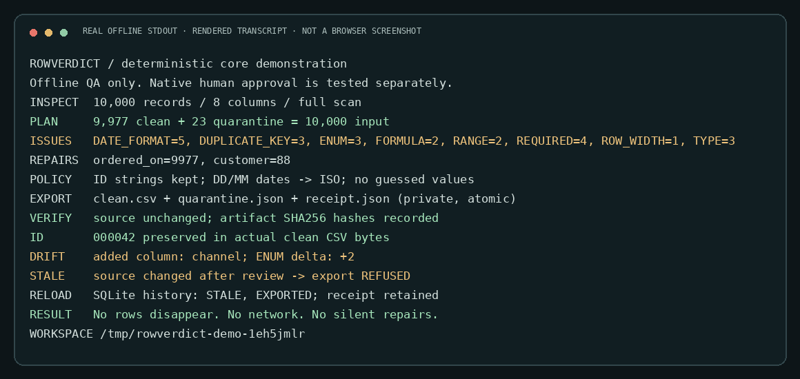

# RowVerdict for Hermes

**Trust the import. Keep the evidence.**

RowVerdict turns a risky CSV import into a reviewable, local transaction:
**inspect → explicit contract → deterministic plan → human approval → clean + quarantine + receipt.**

A model can explain the plan. It cannot quietly guess a date, discard a duplicate,
or export an old plan after the source file changes.

- **Every record checked**, not a reassuring sample. UTF-8/BOM CSV up to 20 MiB / 100,000 data records / 1,000,000 cells.
- **No silent deduplication.** Every row in a conflicting key group is quarantined.
- **Explicit transformations only.** Trim selected fields, normalize a declared date format, or replace a declared decimal separator. String identifiers retain leading zeros.
- **Source-bound review.** SHA-256 of the input bytes + canonical contract bind the plan; changed bytes permanently invalidate an unexported plan.
- **Actual artifacts.** Immutable `clean.csv`, raw-cell `quarantine.json`, and a JSON provenance receipt. The input is never edited. No upload or import occurs.
- **Persistent review desk.** SQLite history, per-record evidence, issue deltas, column drift, and a real Hermes web-dashboard tab.
- **No model, API key or extra package needed for the engine.** Four native tools and a read-only `/rowverdict` command; no MCP wrapper.

## Why this exists

A customer/order/product export can look fine in a chat preview and still contain
conflicting identifiers, ambiguous dates, locale-dependent numbers or spreadsheet
formula payloads. A generic “clean this CSV” prompt does not define which repairs
were approved, prove that every row was accounted for, or detect edits after review.

RowVerdict is an **import preparation tool**, not a database importer, a broad agent
security firewall, a PII anonymizer, or an accounting system.

## Quick start

Requires **Hermes Agent >= 0.23.1** and Python **>= 3.11**. Tested on Linux against
Hermes `v0.23.1` (`3b421578588243f920886e6fe79a6faa87ea026e`). Python processing uses only the standard library;
the optional dashboard API uses FastAPI already supplied by Hermes.

### Local development install (works before publication)

Place this repository in the active profile's plugins directory, for example:

```bash
mkdir -p "${HERMES_HOME:-$HOME/.hermes}/plugins"
cp -R /path/to/rowverdict "${HERMES_HOME:-$HOME/.hermes}/plugins/rowverdict"
hermes plugins enable rowverdict
```

Keep input CSVs in a separate narrow directory, **not inside `.hermes`**. Configure
`config.yaml` in that same Hermes profile (merge with existing settings):

```yaml
plugins:
  enabled:
    - rowverdict
  entries:
    rowverdict:
      settings:
        allowed_roots:
          - /absolute/path/to/csv-inbox
```

`allowed_roots: []` denies all input access. Only the operator configures roots;
there is no tool that broadens them. Use a dedicated CSV inbox, never your whole
home directory. Restart the Hermes conversation/dashboard after installing.

### After the public repository is available

The intended repository is `https://github.com/demir-sama/rowverdict`.
Publication/catalog admission are separate steps; this README does not claim either.
Install the exact reviewed 40-character commit, not a moving branch:

```bash
hermes plugins install https://github.com/demir-sama/rowverdict --ref <FULL_REVIEWED_COMMIT_SHA> --enable
hermes plugins doctor rowverdict --ci
```

### Ask Hermes

> Use RowVerdict to inspect `/absolute/path/to/csv-inbox/orders.csv`. Do not return row samples.
> Propose an explicit contract; keep `order_id` a string, use DD/MM/YYYY dates and dot decimals,
> require known statuses, and quarantine every duplicate identifier. Show me the plan before exporting.

The tools are:

| Tool | Purpose | Writes |
|---|---|---|
| `rowverdict_inspect` | Header, full record count, width issues and source hash; no cell samples | None |
| `rowverdict_plan` | Full deterministic check against an explicit contract | Private SQLite plan metadata |
| `rowverdict_history` | Recent runs, or one `plan_id` with contract, evidence, drift and receipt | Initializes empty private state if needed |
| `rowverdict_export` | Recheck the exact source and request host approval for this plan | Private immutable artifact directory |

`/rowverdict` shows five recent plans; `/rowverdict <plan-id>` shows one plan.
It is deliberately read-only. Review the contract and evidence before approving
`rowverdict_export({"plan_id":"..."})` in your Hermes conversation.

## The contract is the policy

A compact example:

```json
{
  "delimiter": ",",
  "unique_key": ["order_id"],
  "columns": [
    {"name": "order_id", "type": "string", "required": true},
    {"name": "customer", "type": "string", "required": true, "trim": true},
    {"name": "amount", "type": "decimal", "decimal_separator": ".", "min": "0", "max": "1000000"},
    {"name": "ordered_on", "type": "date", "date_format": "%d/%m/%Y"},
    {"name": "status", "type": "string", "enum": ["paid", "pending", "refunded"]}
  ]
}
```

- The **exact ordered header** must match. Missing, extra, duplicate, blank or unsafe headers refuse the plan. Inspect changed files, then explicitly declare a matching new contract.
- Supported types: `string`, `integer`, `decimal`, `date`. `required` defaults to `true`, `trim` to `false`. Whitespace-only required cells are missing, without silently trimming nonblank cells.
- Supported date formats: `%Y-%m-%d`, `%d/%m/%Y`, `%m/%d/%Y`. Explicitly parsed dates export as ISO dates. `02/03/2026` means March 2 **only under a DD/MM contract**; no ambiguity detection or locale guessing is claimed. Python's date parser accepts single-digit day/month components.
- Numeric grammar is bounded ASCII digits with optional leading sign and one explicit decimal separator. No grouping, currency symbols, exponents, `NaN`, infinity, rounding or binary float. Integer text is retained; decimal commas become dots only when requested.
- `min`/`max` are inclusive numeric bounds; `enum` checks the transformed string exactly. Optional empty cells skip type/enum/range checks. Numeric cells are capped at 64 characters; normalized contracts at 64 KiB.
- `unique_key` may be composite. Equality is on the transformed string tuple, not inferred numeric equivalence. All conflicting rows quarantine, including otherwise-invalid rows.
- Blank logical records and incorrect field counts are quarantined. Quoted commas, embedded newlines, Unicode and UTF-8 BOM are supported. Malformed quoting, non-UTF-8, NULs or size limits **refuse**, never sample-pass.
- Leading `=`, `+`, `-`, `@` after whitespace, or a leading tab/CR/LF, is formula-like and quarantined **unless the field is a valid explicitly typed number**. This is a conservative common-formula guard, not a guarantee for every spreadsheet application.

## A receipt, not a promise

Artifacts are atomically published together under:

```text
<active HERMES_HOME>/plugin-data/rowverdict/
├── runs.sqlite3
└── exports/<plan-id>/
    ├── clean.csv
    ├── quarantine.json
    └── receipt.json
```

- `clean.csv` has the original ordered header and only accepted, explicitly transformed rows.
- `quarantine.json` contains **original raw cells**, logical record numbers and every rejection reason. JSON is deliberate: rejected formula-like cells are not emitted as a second spreadsheet CSV. It is sensitive data; do not paste it into a spreadsheet.
- `receipt.json` contains source/policy hashes, engine-source fingerprint, the exact contract, complete counts, bounded evidence, engine version and SHA-256/byte sizes of both data artifacts.
- `input_rows = clean_rows + quarantined_rows`. The header is not counted. A record is a **logical CSV record**, not a physical line; header = 1, first data record = 2.
- Numeric summaries are exact per-column arithmetic only. **They do not group or convert currencies.** Do not interpret a mixed-currency sum as a financial total.
- Repeat exports are idempotent and verify existing file hashes. Damaged artifacts refuse rather than overwrite. A crash after atomic publication can be recovered on retry, provided source bytes are still the reviewed bytes. Local Linux file/directory fsync is used; network filesystem/power-loss behavior is not certified.
- An engine-source change requires a new review before an unexported plan can run. A previously exported plan remains a valid historical snapshot even when the source later changes. Unexported stale plans remain stale even if the original bytes are restored: create a new plan.

SQLite keeps source paths, hashes, contracts, bounded issue metadata and receipts;
it does **not** retain source snapshots or raw rejected cells. A deleted source
cannot be re-exported from the database alone. Artifact directories are `0700`,
files/database `0600` on the tested Linux system. There is no encryption at rest,
automatic deletion or retention scheduler. Delete only your own plugin-data after
backing up needed receipts; updating the plugin does not erase history.

## Dashboard

Launch the real Hermes dashboard (`hermes dashboard`) and choose **RowVerdict**.
It uses only the public dashboard SDK: host React, same-origin authenticated JSON,
and a scoped CSS file. No CDN or bundled React.

The review queue shows plan states and full-scan counts. Tabs expose filtered/sorted
row evidence, the explicit contract, previous-plan column/issue deltas and immutable
receipts. State refresh is manual and survives browser/agent restarts through SQLite.
Only the latest 40 plans appear in the UI (tool history supports up to 100).

**The panel is read-only.** It has no export endpoint and cannot answer approvals.
It shows the exact native tool request to continue in Hermes instead.

### Evidence / screenshots



This is a **rendered terminal transcript**, not a browser screenshot. Actual host API
mounting, authentication and asset serving were tested; all panel tabs were rendered
with the host's real React. A live-browser screenshot and interactive visual QA still
need to be captured. See [verification](docs/VERIFICATION.md); no mock UI is presented
as a real screenshot.

## Reproduce the worldwide demo

The fixture contains **10,000 synthetic worldwide orders across 20 countries**,
quoted commas, an embedded newline, zero-padded IDs and deliberate import mistakes.
All names/transactions are fictional; no real customer data is included.

```bash
python3 scripts/generate_demo.py
python3 -m unittest discover -s tests -v
python3 cli.py --data-dir /tmp/rowverdict-demo-state --root "$PWD/demo" \
  plan "$PWD/demo/orders-worldwide.csv" "$PWD/demo/contract.json"
```

Measured result: **9,977 clean + 23 quarantined = 10,000 input records**.
Issue events: 5 date-format, 3 duplicate-key, 3 numeric-format, 2 formula,
4 required-value, 3 enum, 2 range and 1 record-width. One record can have multiple
events; do not add event counts to infer row counts. 88 customer trims and 9,977
date normalizations are measured on clean rows.

For a manual, offline CLI export after personally reviewing that plan:

```bash
python3 cli.py --data-dir /tmp/rowverdict-demo-state --root "$PWD/demo" \
  export <PLAN_ID> --reviewed-plan <SAME_PLAN_ID>
```

The CLI is an explicit human-invoked development/QA interface, **not** the Hermes
approval gate and never a way to retry a denied agent export. The agent must use
the native tool. See the [80-second demo script](demo/DEMO_SCRIPT.md) and
[reproducible safety demonstration](scripts/demo_run.py).

## Security boundary and honest limits

**Plugin runtime disclosures:** no network calls, telemetry, credentials, shell
commands, subprocesses, background tasks, arbitrary code/SQL evaluation or
self-updating behavior. It reads operator-allowlisted `.csv` inputs outside plugin
storage and writes only its own private plugin-data. No direct credential-store
reads; common credential/config directories are rejected even within a broad root.
Symlink components, traversal paths and non-regular inputs are refused.

- The approval hook covers **only `rowverdict_export` dispatched through Hermes**. It does not intercept shell/file/import tools or turn Python into a sandbox. The operator's host approval policy, including explicit unattended/allowlist decisions, remains authoritative. In ordinary noninteractive runs with no human bridge, the real host refused export during QA.
- Local filesystems and the OS account are trusted. Narrow roots and symlink checks reduce accidents; they do not isolate hostile same-user processes or eliminate all directory replacement races. There is no multi-tenant boundary.
- Paths, column names, contracts, aggregate totals, row numbers and issue codes are returned to Hermes, so its configured model may see them. Raw input cell samples are **not** returned. This is not universal data-loss prevention; other tools can still read the same files.
- First 250 issue events are retained in plan evidence; full counts cover all records and full rejected records are in `quarantine.json` after export. No streaming, Excel/JSON/Parquet, foreign keys, fuzzy matching, format inference, automatic schema migration or import execution.
- Zero padding is preserved in CSV bytes, **not guaranteed when Excel auto-detects numbers**. Import identifier columns as text. No business-rule/currency-pair correctness or regulatory certification is claimed.
- Dependencies: none for the deterministic engine; optional FastAPI/React are host-owned. Development tests are standard-library `unittest`; optional dashboard QA uses an existing Hermes web checkout. No dependencies are downloaded at plugin runtime.
- Verified on Linux/Python 3.13.5 and Hermes-managed Python 3.14.9. Windows/macOS and older Hermes versions are not certified; POSIX file flags/permissions are used.

## Development / admission

```bash
python3 -m unittest discover -s tests -v
node --check dashboard/dist/index.js
hermes plugins doctor /absolute/path/to/rowverdict --ci
hermes plugins validate /absolute/path/to/rowverdict --install-deps
```

The local stable-release admission check passed with a **safe** security scan;
Doctor loaded four tools, one hook and the read-only slash command. Public catalog
CI and maintainer admission cannot happen until a public exact-SHA tree exists.
See [verification](docs/VERIFICATION.md), [security](SECURITY.md), and
[publishing/sign-in handoff](docs/PUBLISHING.md).

MIT licensed. Built for the Nous Research Hermes Agent Plugin Hackathon.
